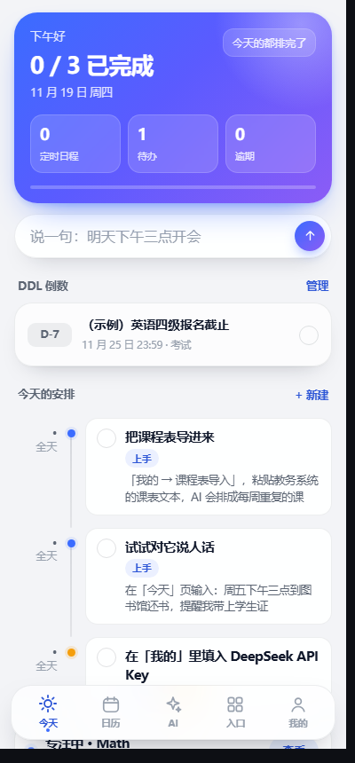
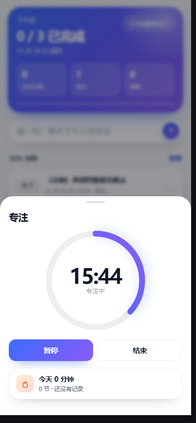
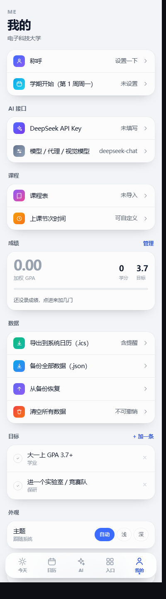
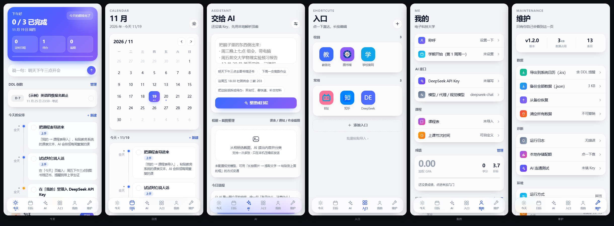

# 序时 · AI 日程（Xushi）

> 给大学生用的 AI 日程 / 备忘录。一句话排安排，相册里的截图自动归类，常用网站一键直达，重要消息不会漏。
> 装在 iPhone 主屏上用，跟原生 App 一样全屏、离线可用，数据只存在你手机上。

<p>
  
  
  
</p>
<p>
  
</p>

---

## 一、它是什么

一个 **PWA（渐进式 Web 应用）**：一个网页，但装到 iPhone 主屏后是全屏 App 的样子，没有地址栏、有图标、能离线打开。

为什么不做原生 iOS App：

| | PWA（本方案） | 原生 SwiftUI |
|---|---|---|
| 需要 Mac + Xcode | 不需要 | 需要 |
| 需要苹果开发者账号 | 不需要 | 免费账号 7 天过期，99 美元/年才能长期 |
| 改一行代码要多久生效 | 刷新页面 | 重新编译 + 重装 |
| 能不能放进主屏 | 能（Safari → 分享 → 添加到主屏幕） | 能 |

代价是：**锁屏推送提醒做不了**（iOS 对网页推送限制很严）。所以重要的时间点用「导出 .ics 到系统日历」来解决——提醒交给 iOS 自己弹，比网页推送可靠得多。

---

## 二、能做什么

### 核心
- **今天**：问候 + 今日进度 + 时间轴（课程 / 日程 / 待办混排）+ 一键新建
- **一句话录入**：`明天下午3点 交电路实验报告` → 自动拆成日程（有时间的）和待办（没时间的），中文时间表达都认（明天 / 下周三 / 周五前 / 晚上七点 / 12月20号）
- **日历**：月视图 + 每天的小圆点（蓝=日程、橙=待办、紫=课程），点一天看当天全部
- **待办收集箱**：没定日子的先扔进来，以后一键「排期」
- **重要消息**：通知 / 缴费 / 报名截止这类信息单独收件箱，标「要处理」，能一键转成待办

### AI（DeepSeek）
- **自然语言整理**：一段话、一张粘贴的通知、一堆乱写的待办 → 结构化条目，带预览，可逐条确认
- **相册读图**：从相册选课表截图 / 群通知 / 作业要求 → AI 读出内容并分类（需要另配一个视觉模型，见下文）
- **今日简报**：让 AI 看一眼今天的安排，给一句「先干什么、注意什么」
- **课表解析**：粘贴教务系统的课表文本 → 自动拆成「周几 + 第几节 + 单双周」
- **没网 / 没 Key 也能用**：内置一套本地规则解析（`明天下午三点去图书馆还书` 也能听懂）

### 其它
- **快捷入口**：网站卡片墙，自动抓 favicon，可分组，支持「批量粘贴导入」（一行一个：`教务处 https://jwc.uestc.edu.cn`）
- **课程表**：按周次 + 节次自动出现在每天的时间轴上，单双周支持（`1-16单`）
- **DDL 倒数**：作业提交、报名截止、考试这类硬截止单独一块，显示 `D-3` / `今天` / `已过期`，导出日历时提前一天和两小时各提醒一次
- **专注 · 番茄钟**：25/45/60 分钟，环形倒计时，可暂停、可记「在做什么」，结束后记进当天专注时长；切走或锁屏也在走（用时间戳算，回来自动对上）
- **成绩 / GPA**：录课程学分和分数，自动算加权 GPA，可选分段制或线性绩点，和「目标 GPA」对比看差多少
- **一周复盘**：AI 读这周的完成/逾期/专注记录，写一段对着你说话的复盘，存历史
- **导出到系统日历**：生成 .ics，用 iPhone 自带日历打开 → 每条日程都会弹原生提醒
- **目标**：绩点、竞赛、实验室这种长期的东西单独记着
- **备份 / 恢复**：一键导出 JSON
- **深色模式**：跟随系统，也可以手动锁定
- **维护页**（我的 → 系统 → 维护）：版本 / 数据占用 / 条目统计、备份恢复、运行日志、存储配额、AI 连通测试、强制刷新 —— 自己用的时候排查问题都在这一页

---

> **想要桌面上那种真 App（不用先开 Safari）？**
> `.ipa` 已经编译好了：`build/Xushi-1.0-unsigned.ipa`（未签名，用 Sideloadly + 免费 Apple ID 装）。
> 完整步骤见 [INSTALL-iOS.md](INSTALL-iOS.md)。代价是每 7 天重签一次（30 秒）。

## 三、五分钟装到 iPhone 上

PWA 必须要 HTTPS，所以得先把它放到一个网址上。三种方式，选一个：

### 方式 A：Cloudflare Pages（免费，推荐，永久网址）

1. 打开 <https://dash.cloudflare.com> → 左侧 **Workers & Pages** → **Create** → **Pages** → **Upload assets**
2. 项目名随便起（比如 `xushi`），把本目录**整个文件夹**拖进去（不要拖外层文件夹，要拖里面有 `index.html` 的那一层）
3. Deploy，拿到形如 `https://xushi.pages.dev` 的网址
4. iPhone Safari 打开这个网址 → 底部 **分享** → **添加到主屏幕**
5. 之后从主屏图标打开，就是全屏 App

> 以后想改东西：同一个项目 → **Create new deployment** → 重新拖一遍文件夹即可，手机上刷新一下就更新。

装好之后建议先做三件事（五分钟）：
1. **我的 → 称呼**：填个名字，首页问候会用
2. **我的 → 学期开始**：填第 1 周的周一（算周次和单双周用）
3. **我的 → DeepSeek API Key**：粘贴 Key，点「测试连接」

然后回「今天」页，在顶部输入框写一句 `明天下午三点图书馆还书`，点发送——能自己排进日程就说明全通了。

### 方式 B：Vercel

```bash
npm i -g vercel
cd 这个文件夹
vercel --prod
```
拿到 `https://xxx.vercel.app`，后面步骤同上。

### 方式 C：只想先在自己电脑上试试

```bash
cd 这个文件夹
python -m http.server 8848
```
电脑上打开 <http://127.0.0.1:8848> 就能用（用 Edge/Chrome 的 F12 → 手机模拟视图看效果）。
手机要访问得同一个 WiFi，用电脑局域网 IP（`http://192.168.x.x:8848`）——**但 http 下装不了 PWA**，只能当普通网页用，Service Worker 不会注册。想真装到主屏还是走 A 或 B。

---

## 四、接上 DeepSeek

1. 去 <https://platform.deepseek.com> 注册，**API keys** 里创建一个 Key（`sk-` 开头），充一点点钱（几块钱能用很久）
2. 手机上打开 App → **我的 → DeepSeek API Key** → 粘贴进去 → 保存
3. 点 **测试连接**，出现「连通正常」就好了

默认配置：

| 项 | 值 |
|---|---|
| 接口地址 | `https://api.deepseek.com` |
| 模型 | `deepseek-chat`（想让它想久一点可以改 `deepseek-reasoner`） |

任何 OpenAI 格式的接口都能填：Kimi（`https://api.moonshot.cn/v1`）、通义、硅基流动、自己电脑上的 Ollama……

### 如果提示「连不上 / 跨域」

浏览器直接请求 AI 接口，有时候会被 CORS 拦住（国内网络环境下尤其常见）。解法是加一个转发代理，**不用改代码**：

1. 打开 <https://dash.cloudflare.com> → **Workers & Pages** → **Create** → **Worker**
2. 把 `worker/worker.js` 的全部内容贴进编辑器 → **Deploy**
3. 拿到 `https://xxxx.你的账号.workers.dev`
4. 回到 App：**我的 → AI 接口 → 代理地址**，填这个地址，保存

这个 Worker 只做三件事：校验目标域名白名单、把你的请求原样转发、补上跨域头。**API Key 仍然只在你手机上，不经过任何第三方服务器。**

### 想让 AI 读相册里的截图

DeepSeek 目前只有文本模型，读图要另配一个视觉模型（都兼容 OpenAI 格式）：

| 服务 | 接口地址 | 模型名 | 说明 |
|---|---|---|---|
| 智谱（推荐） | `https://open.bigmodel.cn/api/paas/v4` | `glm-4v-flash` | 免费，够用 |
| 通义千问 | `https://dashscope.aliyuncs.com/compatible-mode/v1` | `qwen-vl-max` | 识别更强，收费 |
| 硅基流动 | `https://api.siliconflow.cn/v1` | `Qwen/Qwen2-VL-7B-Instruct` | 有免费额度 |

在 **我的 → AI 接口** 里填「视觉模型 / 视觉接口地址 / 视觉模型 Key」三项。Key 留空就复用上面 DeepSeek 的（不同家的话要分开填）。

配好之后：**AI 页 → 从相册选截图 → 读图并整理**，课表截图、辅导员通知、群里发的作业要求都能直接抽出条目。

没配视觉模型也有变通：iPhone 相册里长按图片 → **提取文字** → 粘贴到 AI 页的输入框，一样能整理。

---

## 五、课程表怎么导

1. **我的 → 学期开始**，填第 1 周的周一（用来算「第几周」和单双周）
2. **我的 → 课程表**，粘贴文本。格式很宽松，这样都行：

```
高等数学A   周一 1-2节  品学A101  王老师  1-16周
大学物理     周三 3-4节  立人楼B203        1-16周
电路分析     周五 5-6节  主楼C302          2-16双
```

3. 点 **AI 解析** → 核对一下识别结果 → **确认导入**

之后每天的课程会自动出现在「今天」和「日历」里，跟日程排在同一条时间轴上。

上课节次时间在 **我的 → 上课节次时间** 里改（默认是常见的 11 节制，`08:30-09:15` 一行一节）。改一次就够，全校通用。

---

## 六、DDL / 专注 / GPA / 复盘 怎么用

### DDL 倒数
- 今天页顶部有「DDL 倒数」，显示最近三个，点「管理」增删改
- 徽章含义：`D-7` 还早、`D-3` 变橙、`今天` / `已过期` 变红
- 勾掉右侧圆圈 = 处理完了
- 导出日历时，每个 DDL 会额外带 `提前一天` 和 `提前两小时` 两个提醒

### 专注（番茄钟）
- 今天页往下滑，或点「专注」卡 → 选 25 / 45 / 60 分钟 → 开始
- 可以填「在做什么」，结束时会记进当天统计
- 中途可以暂停、继续、提前结束；**切到别的 App 或锁屏也在走**，回来时间是对的（用时间戳算的，不靠后台计时器）
- 结束会响一声 + 震动 + 弹提示

### 成绩 / GPA
- 我的 → 成绩 → 添加一门：课程名、学分、分数
- 自动算加权 GPA，右上角可填「目标 GPA」，卡片上直接显示还差多少
- 绩点算法两种，按你们教务处的规定选：
  - **分段**（默认）：90+=4.0、85+=3.7、82+=3.3、78+=3.0、75+=2.7、72+=2.3、68+=2.0、64+=1.5、60+=1.0、<60=0
  - **线性**：(分数−50)/10，上限 4.0
- 不及格的课也算进 GPA（按 0 算），这是保研口径的常规做法

### 一周复盘
- AI 页 → 「一周复盘」→ 生成
- 它读的是过去一周：做完的、没做完的、逾期的、课程、DDL、专注时长
- 输出三段：这周推进了什么 / 卡在哪里 / 下周怎么调，不超过 200 字，会直接指出问题
- 生成过的存在「历史」里，连着看能看出节奏

---

## 七、提醒怎么办

网页没法可靠地在后台弹通知，所以：

**我的 → 导出到系统日历（.ics）** → 下载 → 用「日历」打开 → 添加全部。

之后未来 45 天的日程和课程都会进 iPhone 自带日历，每条提前 15 分钟弹原生提醒。改完日程重新导一次就行（会覆盖同 UID 的事件）。

---

## 八、数据与隐私

- 所有数据存在浏览器的 **localStorage** 里，就在这台手机上，没有任何服务器
- API Key 也只存在本地，只发给你填的那个 AI 接口
- 换手机 / 清缓存前记得：**我的 → 备份全部数据（.json）**
- 恢复：**我的 → 从备份恢复**
- 想彻底删干净：**我的 → 清空所有数据**

---

## 九、目录结构

```
.
├── index.html              入口（骨架 + 错误收集）
├── css/style.css           全部样式（视觉系统在这里改）
├── js/store.js             数据层：本地存储 / 日期 / 课表周次 / ics 导出 / 图片压缩
├── js/ai.js                AI 层：提示词、JSON 解析、视觉模型、本地兜底解析
├── js/app.js               界面层：五个 tab 页 + 维护页 + 弹层 + 事件
├── manifest.webmanifest    PWA 配置（名字、图标、颜色）
├── sw.js                   Service Worker（离线缓存）
├── icons/                  图标（由 make-icons.py 生成）
├── worker/worker.js        Cloudflare Worker 跨域代理
├── install.html            安装页：生成 .mobileconfig 安装包
├── start-local.bat         一键局域网模式（不用域名，Windows 双击）
├── make-mobileconfig.js    命令行生成描述文件
├── native/                 iOS 原生工程（Capacitor 封装，含图标 / 权限 / 插件）
├── .github/workflows/      GitHub Actions：点一下自动编译出 .ipa
├── INSTALL-iOS.md          装成真 App 的完整步骤（侧载 / 签名 / 7 天重签）
├── SIGN.md                 签名安装的一页纸（已经编好 ipa，照着点就行）
├── build/                  编译产物：Xushi-1.0-unsigned.ipa
├── optional-functions/     可选：给站点加一道口令
├── make-icons.py           图标生成脚本（要改配色/图形就改这个再跑一次）
└── preview/                截图与自检页（部署时可以不传）
```

改配色：`css/style.css` 顶部的 `:root` 里 `--accent` / `--accent-2` 两个值就是主色。

改图标：

```bash
pip install pillow numpy
python make-icons.py
```

自带的自检页：`preview/autotest.html`（浏览器打开，会跑 38 项交互检查，全绿说明没改坏）。

---

## 十、已知限制

- **后台推送**：做不了，用 .ics 导出替代（见第六节）
- **小组件 / 灵动岛**：网页做不了，需要原生
- **多设备同步**：目前是本地存储，换设备靠 JSON 备份。要同步得加后端（Cloudflare D1 / Supabase 都行）
- **相册批量读图**：一次最多 6 张，多了会慢
- **AI 输出的日期偶尔会差一天**：所以所有 AI 结果都是「先预览、再确认」，不会直接写进去
- **番茄钟在 App 完全杀掉后不会响铃**：回来打开会发现已经结束并计入记录，但那一刻的铃声不会补
- **GPA 算法各校不同**：内置两种常见的，按教务处规定选，别直接拿去报推免

---

## 十一、还能往哪加

按性价比排：

1. **周视图 / 时间块拖拽**：现在只有月视图 + 日列表，周视图对排时间更有用
2. **重复日程**（每周 / 每两周）：课程已经有了，普通日程还没有
3. **云端同步**：Supabase 免费版足够，一次登录，多设备同一份数据
4. **AI 周报**：一周结束时让 AI 总结「这周干了什么、下周该补什么」，对保研复盘特别有用
5. **成绩 / GPA 记录**：把每门课学分和绩点存下来，自动算加权 GPA，和「目标 GPA」联动
6. **番茄钟**：从某条待办直接开始 25 分钟专注，记录每天专注时长
7. **DDL 倒数**：作业、竞赛报名、四六级这类硬截止日单独一个倒数区
8. **OCR 离线化**：接 Tesseract.js，不配视觉模型也能读图（代价是首次加载慢）

---

## 许可

自己用、改、发给同学都行。
